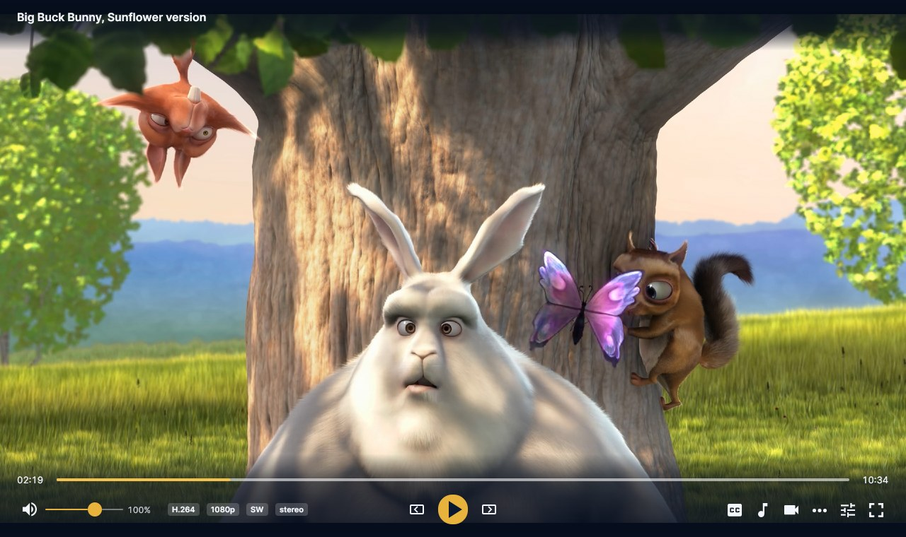
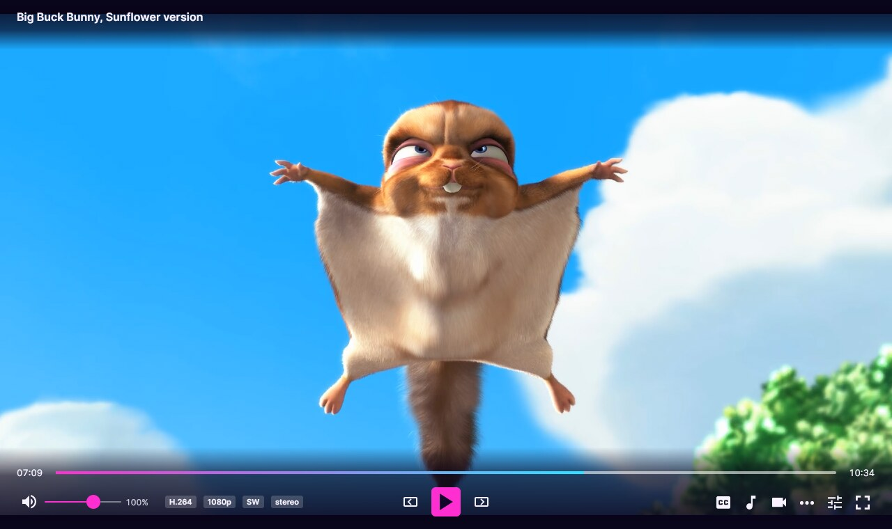
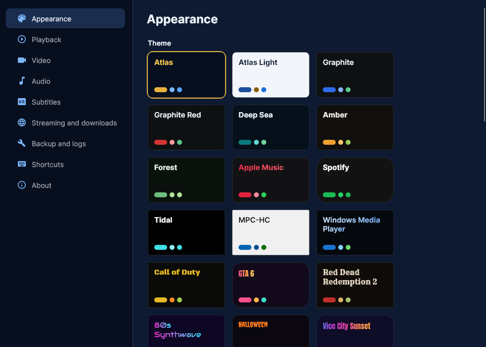
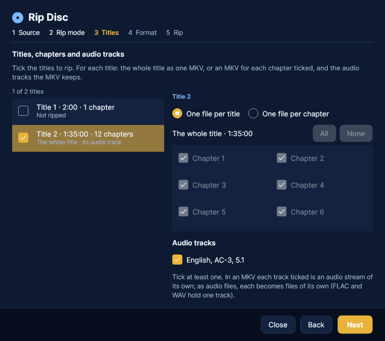

<p align="center">
  
</p>

<h1 align="center">Atlas Player</h1>

<p align="center">
  A video player for Windows and Linux that plays almost anything, streams torrents and web video,<br>
  and rips your CDs and DVDs.
</p>

<p align="center">
  <a href="https://github.com/raulblideran/atlas-player/releases/latest"></a>
  <a href="https://github.com/raulblideran/atlas-player/actions/workflows/ci.yml"></a>
  <a href="LICENSE"></a>
</p>



Atlas Player is built on [mpv](https://mpv.io), so it plays what mpv plays: HEVC and AV1, 10-bit,
HDR (tonemapped to your screen, or passed through), every subtitle format, with hardware decoding
where your GPU has it. Around that it adds the things I kept reaching for other apps to do:
streaming a magnet link without waiting for the download, playing DVDs and Blu-rays with their
menus, and ripping discs properly.

## Features

- **Plays local files, folders and disc images**: drop them on the window. Subtitles next to a video load by themselves. A CD rip's folder plays its tracks (by its cue sheet, as chapters, where it has one) with its cover.jpg or front.jpg on screen.
- **Evens out the volume** by default (peaks to -3 dB, adjustable in Settings → Audio), or plays it exactly as recorded.
- **Streams magnet links and torrent files** while they download, with seeking. Nothing is kept afterwards.
- **Plays links**: YouTube and about 1,800 other sites (through yt-dlp), MEGA file links, and direct video URLs. Paste one with Ctrl+V.
- **Downloads videos** from those sites at the quality you pick, or just the audio.
- **Discs**: DVDs and Blu-rays with their menus, Audio CDs track by track, SACD images.
- **Rips CDs** the careful way: secure reads, drive offset correction, AccurateRip verification, tags and cover from MusicBrainz, FLAC or WAV, an optional cue sheet, and a log.
- **Rips DVDs** to MKV (video copied, or encoded with x264/x265 and deinterlaced with BWDIF or QTGMC), to FLAC/WAV audio only, or as a decrypted VIDEO_TS backup. You pick the titles, chapters and audio tracks.
- **24 themes**, from the default gold and navy to a few playful ones, and a controls bar you can rearrange.
- **Portable on Windows**: unzip and run. Settings stay in the folder, nothing touches the registry.

<table>
  <tr>
    <td></td>
    <td></td>
  </tr>
  <tr>
    <td align="center">Same player, 80s Synthwave theme</td>
    <td align="center">Settings → Appearance</td>
  </tr>
</table>

## Install

Downloads are on the [releases page](https://github.com/raulblideran/atlas-player/releases).

### Windows

Unzip `AtlasPlayer-<version>-portable-win-x64.zip` wherever you like and run `AtlasPlayer.exe`.
To update, unzip the new version over the old folder; your settings and screenshots are kept.

Everything the app writes lives next to the exe: `settings.json`, `Screenshots/`, `cache/`
(torrent data while it plays, deleted afterwards) and `portable_config/` (an optional `mpv.conf`,
`input.conf` or shaders if you want to tweak mpv yourself).

### Linux (Flatpak)

```sh
flatpak install --user atlas-player-<version>.flatpak
flatpak run io.github.raulblideran.AtlasPlayer
```

The bundle brings its own FFmpeg with all the decoders (the Flatpak runtime's copy leaves out
H.264, HEVC, AAC and AC-3). Settings live in `~/.var/app/io.github.raulblideran.AtlasPlayer/`,
screenshots go to `~/Pictures/Atlas Player/`, rips to `~/Music` and `~/Videos`.

A few things worth knowing:

- **NVIDIA's proprietary driver** needs the matching Flatpak GL extension. The app tells you at
  start if it's missing, with the exact `flatpak install` command.
- **Drives under `/var/mnt`** (Bazzite and other atomic distros) aren't visible by default:
  `flatpak override --user --filesystem=/var/mnt:ro io.github.raulblideran.AtlasPlayer`
- **Wayland**: the window is X11, so you need Xwayland. KDE and GNOME always have it; on sway,
  Hyprland or niri, turn it on.
- If something goes wrong, Settings → Backup and logs → **Create log** saves a report you can
  attach to an issue.

## Keyboard shortcuts

| Key | Action | Key | Action |
|---|---|---|---|
| Space | Play / pause | F, Enter, double-click | Fullscreen |
| ← / → | Seek 5 s | Ctrl+← / → | Seek 60 s |
| ↑ / ↓, mouse wheel | Volume | M | Mute |
| . / , | Next / previous frame | Page Down / Page Up | Next / previous chapter |
| A / J | Next audio / subtitle track | V | Hide subtitles |
| Z / X | Subtitle delay −/+ 0.1 s | D | Deinterlace on / off |
| S / Shift+S | Screenshot / with subtitles | I | Statistics |
| Ctrl+O | Open file | Ctrl+U / Ctrl+V | Open link / play a copied link |

The full list is in Settings → Shortcuts.

## Ripping



**Open → Rip Disc…** walks you through it a step at a time, and the steps depend on the disc.

For an **Audio CD** you check the tags and tracks (looked up on MusicBrainz), pick FLAC or WAV,
decide whether you want a cue sheet, and rip. Every block is read until two reads agree, the
result is checked against AccurateRip, and a log is written in the familiar EAC-style layout.

For a **DVD** (a drive, an `.iso` or a `VIDEO_TS` folder) you choose between a full MKV, audio
only, or a decrypted backup of the whole disc, then the titles and audio tracks: each title as
one file, or one file for each chapter you tick. MKVs
can keep the original MPEG-2 or be encoded with x264 or x265; interlaced video is deinterlaced
with BWDIF or QTGMC, at the disc's frame rate or double it. Multichannel audio stays multichannel
unless you ask for stereo.

## Building from source

You'll need the .NET 10 SDK, Rust, and (for the tests) FFmpeg and libmpv.

```sh
./build/fetch-libs.sh linux-x64                 # builds the Rust torrent library
dotnet run --project src/AtlasPlayer.App        # run it
./build/test.sh                                 # Rust and .NET test suites
```

Packaging:

```sh
./build/publish-win.sh       # dist/AtlasPlayer-<version>-portable-win-x64.zip
./build/publish-flatpak.sh   # dist/atlas-player-<version>.flatpak, installed for your user
```

The Flatpak build needs `org.flatpak.Builder` and the 25.08 SDK with the `rust-stable` and
`dotnet10` extensions. The first build compiles FFmpeg, mpv and their dependencies and takes a
while; after that only the app is rebuilt. Pushing a `v<version>` tag builds both packages on
GitHub Actions and publishes a release with the matching `CHANGELOG.md` section as its notes.

### How it fits together

```
src/AtlasPlayer.App      Avalonia UI: windows, overlay controls, dialogs, settings
src/AtlasPlayer.Core     playback (libmpv, libVLC for disc menus), ripping, settings
native/atlas-torrent     Rust: librqbit torrent streaming and MEGA links, served over localhost HTTP
packaging/               Flatpak manifest, desktop entry, AppStream metadata
```

mpv draws straight into a native child window, so its full GPU pipeline is kept; the controls are
small transparent windows floated on top. Torrents are exposed to mpv as an HTTP stream, and each
range request tells librqbit which pieces to fetch first.

## Contributing

Bug reports and pull requests are welcome. For playback problems, please attach the log from
Settings → Backup and logs → **Create log** (made while the video is playing), since it includes
the codec, the GPU and what mpv decided to do.

## Credits

Atlas Player is a free, non-commercial hobby project: no ads, no tracking, no accounts and no
paid features. It stands almost entirely on other people's work, shared freely:
[mpv](https://mpv.io), [FFmpeg](https://ffmpeg.org), [libplacebo](https://code.videolan.org/videolan/libplacebo),
[VLC/libVLC](https://www.videolan.org/vlc/libvlc.html) and VideoLAN's disc libraries
(libdvdcss, libdvdread, libdvdnav, libbluray, libudfread), [x264](https://www.videolan.org/developers/x264.html),
[x265](https://www.x265.org), [FLAC](https://xiph.org/flac/), [VapourSynth](https://www.vapoursynth.com)
with QTGMC and its plugins, [yt-dlp](https://github.com/yt-dlp/yt-dlp),
[QuickJS-NG](https://github.com/quickjs-ng/quickjs), [librqbit](https://github.com/ikatson/rqbit),
[Avalonia](https://avaloniaui.net), [.NET](https://dotnet.microsoft.com), the
[Inter](https://rsms.me/inter/) font and [Material Design Icons](https://pictogrammers.com), with
disc information from [MusicBrainz](https://musicbrainz.org), the
[Cover Art Archive](https://coverartarchive.org) and [AccurateRip](http://www.accuraterip.com).

**[CREDITS.md](CREDITS.md)** lists every one of them, and every library and Rust crate they
bring, with its authors and licence. It ships next to the app too. Atlas Player was developed with
the help of [Claude Code](https://claude.com/claude-code) (Anthropic). The screenshots show
[Big Buck Bunny](https://peach.blender.org), © Blender Foundation, CC BY 3.0.

## License

GPL-3.0-or-later; see [LICENSE](LICENSE). The bundled libmpv is GPL, which sets the license for the
whole package.
